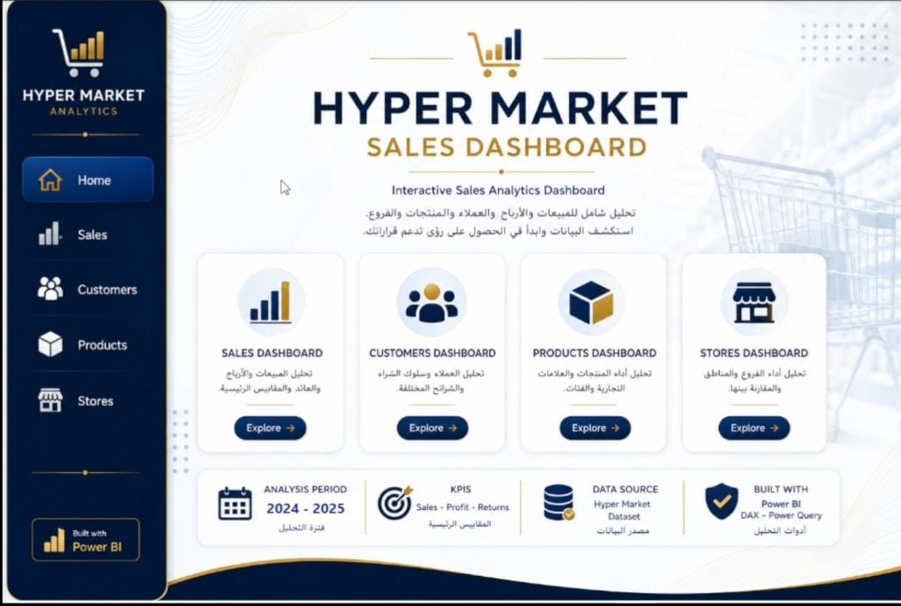
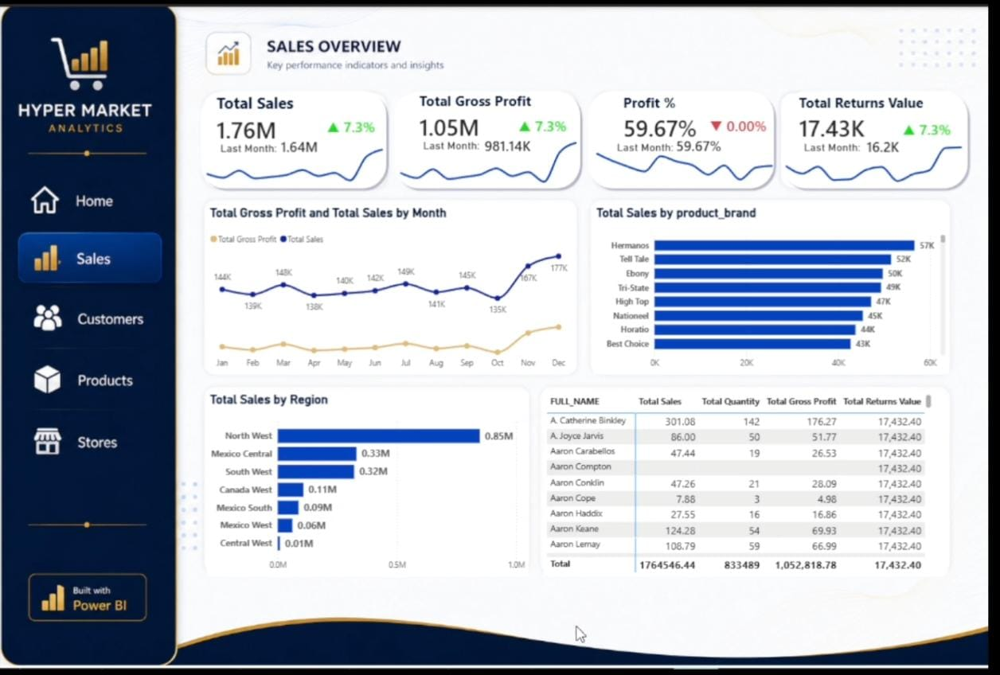
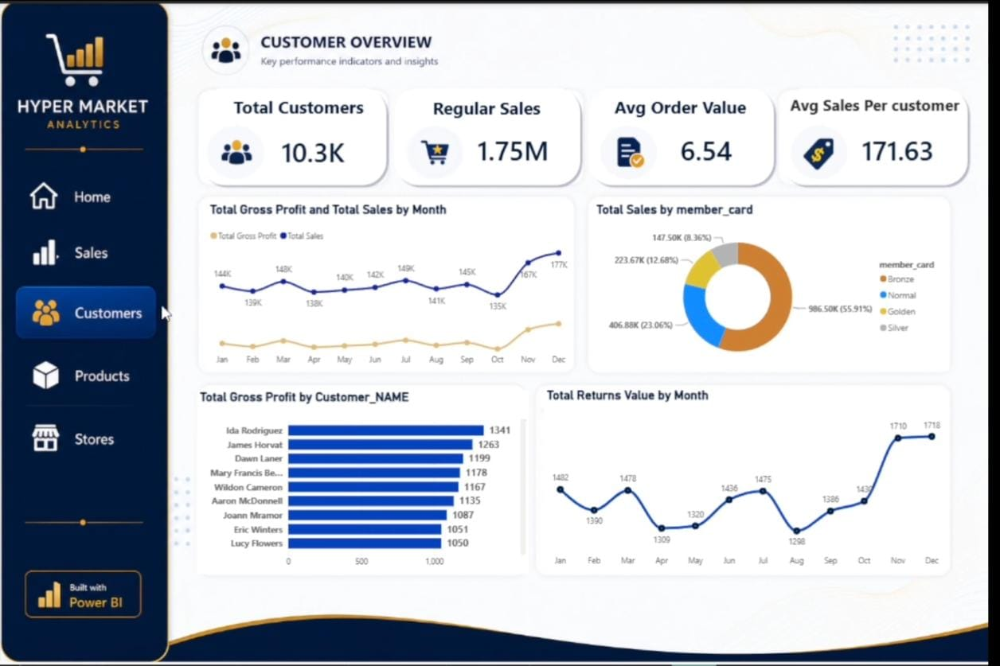
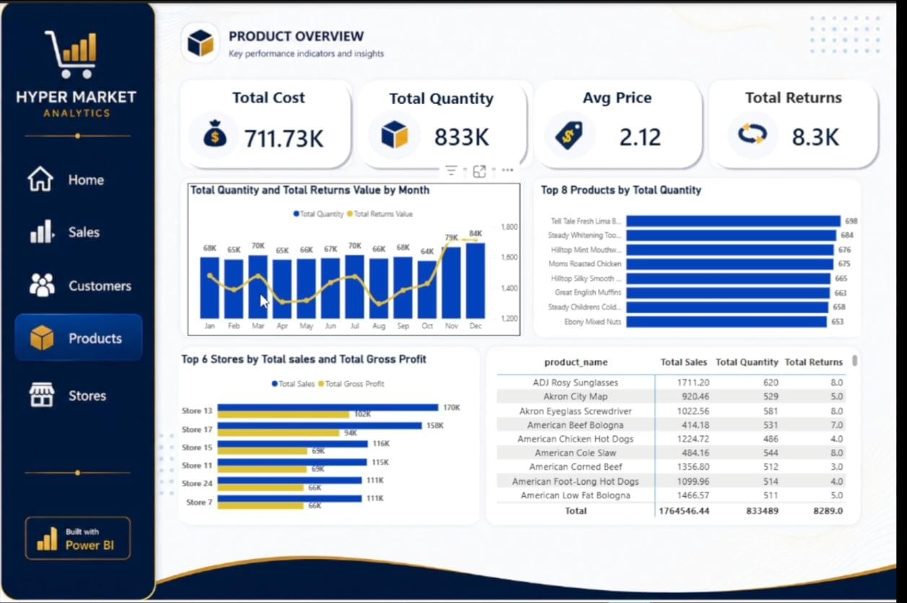
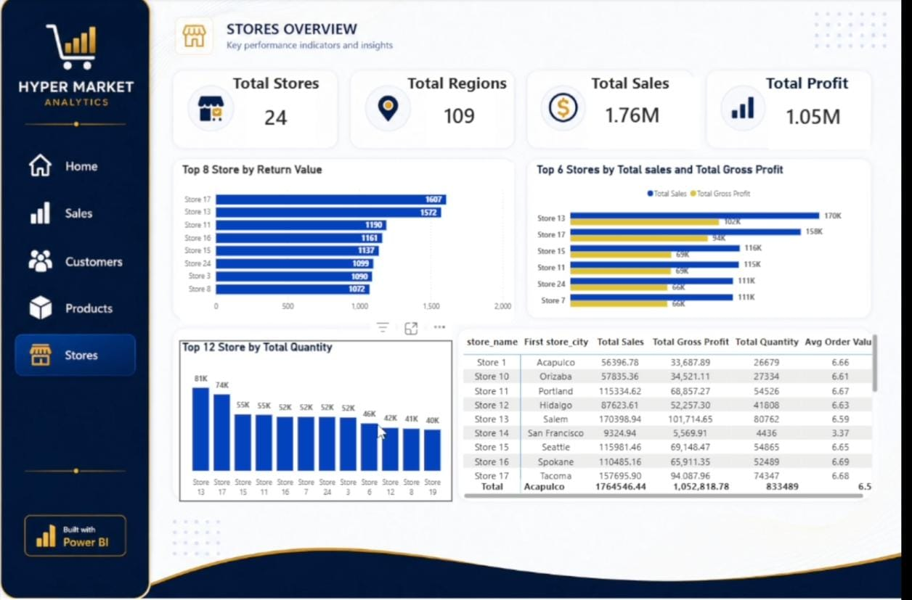

# Hyper Market Sales Dashboard

**Interactive Sales Analytics Dashboard**

An interactive Power BI dashboard analyzing hyper market sales for 2024 - 2025: sales, gross profit, returns, customers, products and stores, with a custom sidebar navigation and a navy/gold design.

## Project Question

How is the hyper market performing across sales, profit and returns, and which brands, regions, customer tiers, products and stores drive the results?

## Dashboard Pages

| Page | What it answers |
|---|---|
| **Home** | Landing page with navigation cards, analysis period, KPIs and data source |
| **Sales Overview** | Total sales, gross profit, profit % and returns value vs last month; monthly trend; sales by brand and region |
| **Customer Overview** | Total customers, average order value, sales per customer; sales by membership card; top customers by gross profit; returns by month |
| **Product Overview** | Total cost, quantity, average price and returns; top products by quantity; top stores by sales and profit; product table |
| **Stores Overview** | Store count, sales and profit; stores ranked by returns, sales, profit and quantity; store comparison table |

## Key Metrics (2024 - 2025, as shown in the report)

- **Total Sales:** 1.76M
- **Total Gross Profit:** 1.05M (Profit % 59.67%)
- **Total Returns Value:** 17.43K (8.3K returned units)
- **Total Cost:** 711.73K
- **Total Quantity:** 833K
- **Total Customers:** 10.3K
- **Total Stores:** 24
- **Avg Order Value:** 6.54 | **Avg Sales per Customer:** 171.63 | **Avg Price:** 2.12

## Key Insights

- Monthly sales stay in a 135K - 149K band from January to October, then rise to 167K in November and 177K in December.
- North West is the largest sales region at 0.85M, well ahead of Mexico Central (0.33M) and South West (0.32M).
- Brand sales are tightly grouped: the top brand, Hermanos, has 57K, followed by Tell Tale (52K) and Ebony (50K).
- Bronze members generate the most sales: 986.50K (55.91%), followed by Normal (23.06%), Golden (12.68%) and Silver (8.36%).
- Store 13 (170K) and Store 17 (158K) lead in sales and profit, and also have the highest return values (1,572 and 1,607).
- Returns value follows the sales peak: it climbs from about 1.3K in August to 1.7K in November and December.

## Data Model

- **Dimensions:** Calendar, Customers, Products, Region, Stores
- **Measures table:** `_MEASURES` with DAX measures including Total Sales, Total Gross Profit, Profit %, Total Cost, Total Quantity, Total Returns, Total Returns Value, Avg Order Value, Avg Price, Avg Sales per Customer, Regular Sales, Total Stores and Total Regions
- **Time intelligence:** last-month comparison and month-over-month change for sales, profit, profit % and returns, with trend indicators
- **Extras:** tooltip page with a sales gauge against a target, KPI cards, custom icons and page backgrounds

## Data Preparation and Challenges

- **Data model:** the report uses several tables (Customers, Products, Stores, Region, Calendar). I connected them in a star schema and kept all measures in a separate `_MEASURES` table.
- **Time intelligence:** built a Calendar table so months sort Jan to Dec, then wrote last-month and month-over-month measures with trend indicators for sales, profit, profit % and returns.
- **Customers without sales:** some customers have no sales in the period. They stay in the customer list, so Total Customers (10.3K) counts all customers and not only buyers.
- **Cleaning in Power Query:** standardized text fields (trimmed spaces, consistent casing) and set correct data types for dates, quantities and prices.
- **Readable visuals:** with thousands of customers and products, I used Top N views (top products, top stores) and a tooltip page instead of long lists.

## Known Limitations / Next Steps

- **Returns by customer:** Total Returns Value shows the same total on every customer row in the Sales Overview table. Returns are not yet linked to individual customers. Next step: relate returns to customers in the model.
- **Total Regions card:** the Stores page shows 109 regions next to 24 stores and 8 sales regions. The card likely counts a different level of the region data. Next step: relabel it or count the sales region field.

## Tools

- Power BI Desktop (data modeling, report design)
- DAX
- Power Query

## Screenshots

### Home

### Sales Overview

### Customer Overview

### Product Overview

### Stores Overview

## Files

- `Hyper-Market-Sales-Dashboard.pbix` - full Power BI report with embedded data
- `screenshots/` - dashboard page screenshots

## Author

**Zeyad Ashraf** - Data Analyst
[LinkedIn](https://www.linkedin.com/in/zeyad-ashraf-065794371) | [GitHub](https://github.com/Zeyada0) | [Portfolio](https://zeyada0.github.io/portfolio/)
